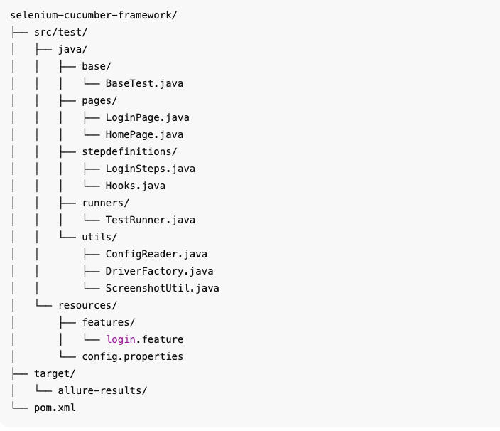

# 🚀 Selenium Cucumber Framework

A BDD-style test automation framework using Selenium WebDriver and Cucumber, built with a clean Page Object Model (POM) architecture for better maintainability and scalability.

## 🧩 Project Structure

## ⚙️ Prerequisites

Java 11 or higher

Maven 3.6 or higher

Chrome or Firefox browser installed

## 🌟 Key Features

✅ Page Object Model (POM) for reusable and maintainable code
✅ Behavior Driven Development (BDD) using Cucumber
✅ Multi-browser support (Chrome, Firefox)
✅ Configurable setup via config.properties
✅ Automatic screenshot capture on test failures
✅ Allure HTML reports for visual test reporting
✅ Parallel execution support (optional via Cucumber-JVM plugin)

## 🧪 Writing Tests

Create a Feature File

Add under: src/test/resources/features

Example: login.feature

Feature: Login Functionality
Scenario: Successful login with valid credentials
Given user is on login page
When user enters valid username and password
Then user should be navigated to the home page

Implement Step Definitions

Add steps in: src/test/java/stepdefinitions/LoginSteps.java

Add Page Objects

Define element locators and actions in src/test/java/pages/

## 🧠 Best Practices

Keep locators and logic separated (strict POM structure).

Avoid hard-coded waits; use WebDriverWait for dynamic synchronization.

Reuse steps where possible across features.

Use tags (@smoke, @regression, etc.) to control execution scope.

## 🧱 Future Enhancements

✅ Integrate with Jenkins for CI/CD pipeline

✅ Add Docker support for scalable test execution

✅ Extend support for API testing using RestAssured

✅ Add retry mechanism for flaky tests